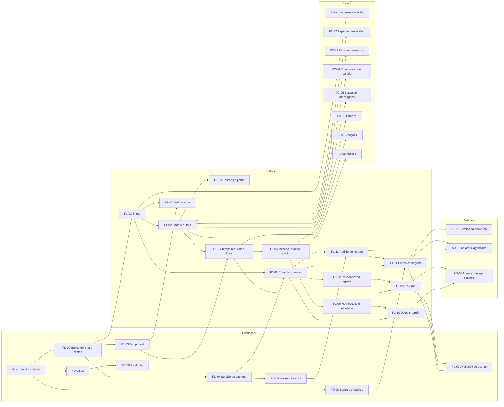

# Roadmap — Full Cycle Chat

2026-11-13 · Status: rascunho

As funcionalidades a desenvolver, com o que cada uma entrega, do que depende, o que a trava e em
que pé está. O objetivo de cada fase e o critério para começar a Fase 2 ficam no
[product brief](product-brief.md), seção "Roadmap"; o detalhe de cada item da Fase 1, na seção
"Escopo do MVP" do brief, pelo mesmo número do ID (`F1-09` é o item 9).

## Como ler

**Status**

| Status | Quando |
| --- | --- |
| Pendente | Existe só no brief, ou no máximo no HLD |
| Especificada | As decisões que a travam estão resolvidas e há um plano de implementação pronto para executar (spec, tickets ou issues), apontado na coluna Plano |
| Concluída | Mergeada na `main`, com testes, funcionando no ambiente local |

"Especificada" não é a Situação `planejada` do LLD: lá, `planejada` quer dizer prevista e ainda
inexistente, o que aqui é Pendente.

**Colunas**

- **ID:** `FD` para Fundações, `F1` e `F2` para as fases, `AD` para o que está a definir.
- **Ao final, a pessoa consegue:** o que fica possível quando a linha é concluída. Sem ator
  explícito, é qualquer membro do workspace; nas Fundações, é quem desenvolve ou opera.
- **Depende de:** IDs que precisam estar concluídos antes.
- **Bloqueios:** questões em aberto do brief, do HLD ou do LLD que precisam de resposta antes de a
  linha virar Especificada, citadas pelo documento e pela seção.
- **Plano:** link da spec, dos tickets ou das issues.

## Mapa de dependências

**Dependências entre funcionalidades e fundações**

Legenda: `A --> B` quer dizer que B depende de A. O status fica só nas tabelas abaixo.

## Fundações

| ID | Fundação | Ao final, a pessoa consegue | Depende de | Bloqueios | Plano | Status |
| --- | --- | --- | --- | --- | --- | --- |
| FD-01 | Ambiente local | Subir `web`, `chat-api`, Postgres com os três bancos e o S3 com o Docker Compose e rodar os comandos dentro dos contêineres | — | — | — | Pendente |
| FD-02 | Banco do chat e contas | Rodar as migrações do Banco do chat e criar contas e permissões pelo comando da API do chat | FD-01 | LLD, Questões em aberto, "Dados e interfaces": canais e conversas diretas numa tabela ou em tabelas separadas; bots na tabela das pessoas; diagrama de entidades | — | Pendente |
| FD-03 | Tempo real | Abrir o WebSocket (Socket.IO) com o cookie de sessão, receber os eventos tipados de `packages/chat-events/` e, depois de uma queda, receber o que perdeu | FD-02 | LLD, Questões em aberto, "Conceitos transversais": publicação do evento depois do commit. LLD, "Ambiente de desenvolvimento": o Redis da reconexão entra no compose com o projeto `agents` | — | Pendente |
| FD-04 | Serviço de agentes | Subir o projeto `agents` (FastAPI + ADK) com o registro de agentes, as credenciais de serviço e de bot, o identificador de pedido, o limite de pedidos e o teto de custo | FD-02 | LLD, Questões em aberto, "Estrutura e bibliotecas": acesso ao modelo; acesso ao Banco dos agentes. "Conceitos transversais": credenciais de bot e de serviço. "Valores, configuração e ambiente": teto de custo por pedido | — | Pendente |
| FD-05 | Worker, fila e S3 | Enfileirar um pedido demorado, consumi-lo no Worker, gravar o arquivo no S3 e baixá-lo por URL assinada | FD-04 | LLD, Questões em aberto, "Estrutura e bibliotecas": fila; PDF. "Valores, configuração e ambiente": endereço da URL assinada no local. HLD, Questões em aberto: retenção dos PDFs | — | Pendente |
| FD-06 | Banco de negócio | Carregar dados de vendas de exemplo pelo script e consultá-los com o usuário só leitura | FD-01 | — | — | Pendente |
| FD-07 | Avaliação do agente | Rodar os 73 casos e comparar versões de prompt e de modelo antes de trocar | F1-09, F1-10, F1-11 | HLD, Questões em aberto: quando roda a avaliação e se bloqueia a implantação | — | Pendente |
| FD-08 | CI | Ver os testes e a conferência dos snapshots OpenAPI rodarem em cada PR | FD-01 | — | — | Pendente |
| FD-09 | Produção | Implantar na PaaS por pipeline, com HTTPS e volta automática à versão anterior | FD-08 | HLD, Questões em aberto: qual PaaS; orçamento; dimensionamento; alertas | — | Pendente |

## Fase 1 — fechar o MVP

| ID | Funcionalidade | Ao final, a pessoa consegue | Depende de | Bloqueios | Plano | Status |
| --- | --- | --- | --- | --- | --- | --- |
| F1-01 | Entrar | Entrar com e-mail e senha numa conta criada pela empresa, seguir com a sessão em todas as abas do navegador até sair ou ela ser revogada, e trocar a própria senha | FD-02 | LLD, Questões em aberto, "Conceitos transversais": `SameSite` e CSRF; identificador de sessão; hash de senha; chave do limite de tentativas. "Dados e interfaces": como o BFF leva a sessão à API do chat | [PRD](f1-01-entrar/prd.md) ([issue #2](https://github.com/luzardoarruda66/Imersao-FullCycle/issues/2)) | Pendente |
| F1-02 | Canais e conversas diretas | Conversar em canais públicos, privados e conversas diretas; criar canal público ou privado e convidar pessoas para um privado, que só os convidados veem | F1-01 | LLD, Questões em aberto, "Conceitos transversais": lugar da conferência de participação. "Dados e interfaces": paginação | — | Pendente |
| F1-03 | Pessoas e perfis | Buscar pessoas por nome ou @usuário, abrir uma conversa direta e ver o perfil de qualquer pessoa | F1-02 | — | — | Pendente |
| F1-04 | Tempo real e não lidas | Ver as mensagens chegarem na hora, com "digitando", histórico paginado e contagem de não lidas e de menções | F1-02, FD-03 | HLD, Questões em aberto: critério do tempo real. LLD, Questões em aberto, "Conceitos transversais": contadores quando a leitura não vai até a última mensagem | — | Pendente |
| F1-05 | Menção, citação e edição | Mencionar pessoas, responder citando, copiar texto, editar e apagar as próprias mensagens, com a mudança aparecendo para todos na hora | F1-04 | LLD, Questões em aberto, "Estados, regras e processos": mensagem (exclusão com menções, notificações e contadores; edição que acrescenta menção) | — | Pendente |
| F1-06 | Notificações e Atividade | Receber notificação de menção e de DM, na tela e, se ligar, do navegador; clicar e cair na mensagem; ver Menções, DMs e Tarefas em Atividade (as tarefas chegam com F1-10) | F1-05 | — | — | Pendente |
| F1-07 | Perfil e tema | Editar o próprio perfil (nome, cargo, telefone, status, presença) e escolher o tema claro ou escuro | F1-01, FD-03 | LLD, Questões em aberto, "Estados, regras e processos": presença e "digitando" | — | Pendente |
| F1-08 | Conectar agentes | Como administrador, conectar e desconectar agentes do workspace; quem não administra vê os agentes e a quem pedir | F1-01, FD-04 | — | — | Pendente |
| F1-09 | Resumo da conversa | Pedir a um agente um resumo com recorte (hoje, desde ontem, a semana, tudo, uma pessoa, um assunto) e, sem recorte, escolher por botões que mostram quantas mensagens cada opção cobre | F1-04, F1-12 | — | — | Pendente |
| F1-10 | Delegar tarefa | Pedir a um agente que delegue uma tarefa a uma pessoa mencionada; quem recebe é notificado, vê a tarefa em Atividade e a conclui ou reabre, e quem delegou é avisado | F1-06, F1-08 | LLD, Questões em aberto, "Estados, regras e processos": concluir tarefa já concluída ou reabrir uma aberta | — | Pendente |
| F1-11 | Dados de negócio | Contar, somar e comparar dados de vendas em linguagem natural e receber a resposta em texto e, se pedir, um PDF; quem não tem permissão de dados vê a resposta bloqueada | F1-08, F1-13, FD-06 | HLD, Questões em aberto: mecanismo de isolamento entre conversa e consulta; lugar e retenção da auditoria; LGPD. LLD, Questões em aberto: parser da conferência de somente leitura; consulta a dados de negócio (comparação do lastro); função única que monta a mensagem por destinatário; tempo limite da consulta | — | Pendente |
| F1-12 | Responder ao agente | Responder a uma pergunta de um agente sem mencioná-lo de novo, ou com um clique numa resposta pronta | F1-08 | LLD, Questões em aberto, "Estados, regras e processos": pedido ao agente (resposta como pedido novo ou continuação); pergunta pendente (quando termina) | — | Pendente |
| F1-13 | Pedido demorado | Pedir algo demorado e seguir conversando: o agente avisa que começou e entrega o resultado na conversa quando termina | F1-08, FD-05 | LLD, Questões em aberto, "Estados, regras e processos": idempotência da tarefa do PDF. "Valores": tentativas do Worker | — | Pendente |

## Fase 2 — operar como produto

O HLD e o LLD cobrem só a Fase 1: toda linha desta fase tem como bloqueio o desenho da Fase 2.

| ID | Funcionalidade | Ao final, a pessoa consegue | Depende de | Bloqueios | Plano | Status |
| --- | --- | --- | --- | --- | --- | --- |
| F2-01 | Cadastro e convite | Como administrador, cadastrar e convidar pessoas pelo próprio produto, sem script | F1-01 | Desenho da Fase 2 | — | Pendente |
| F2-02 | Papéis e permissões | Como administrador, dar e retirar o papel de administrador e a permissão de dados numa tela | F1-01 | Desenho da Fase 2 | — | Pendente |
| F2-03 | Remover membros | Remover membros de um canal privado | F1-02 | Desenho da Fase 2 | — | Pendente |
| F2-04 | Entrar e sair de canais | Entrar e sair de canais | F1-02 | Desenho da Fase 2 | — | Pendente |
| F2-05 | Busca de mensagens | Buscar mensagens | F1-02 | Desenho da Fase 2 | — | Pendente |
| F2-06 | Threads | Responder em thread | F1-05 | Desenho da Fase 2 | — | Pendente |
| F2-07 | Reações | Reagir a mensagens | F1-04 | Desenho da Fase 2 | — | Pendente |
| F2-08 | Anexos | Anexar arquivos às mensagens | F1-02 | Desenho da Fase 2 | — | Pendente |

## A definir

Itens sem fase. Se entram no roadmap ou ficam fora é questão em aberto do brief.

| ID | Funcionalidade | Ao final, a pessoa consegue | Depende de | Bloqueios | Plano | Status |
| --- | --- | --- | --- | --- | --- | --- |
| AD-01 | Gráfico na conversa | Receber um gráfico dos dados de negócio na conversa | F1-11 | Brief, Questões em aberto: gráfico na conversa e relatório agendado | — | Pendente |
| AD-02 | Relatório agendado | Receber um relatório de dados de negócio numa agenda definida | F1-11, F1-13 | Brief, Questões em aberto: gráfico na conversa e relatório agendado | — | Pendente |
| AD-03 | Agente que age sem ser chamado | Receber lembrete de tarefa parada e resumo automático do dia sem pedir | F1-09, F1-10 | Brief, Questões em aberto: agente que age sem ser chamado | — | Pendente |
